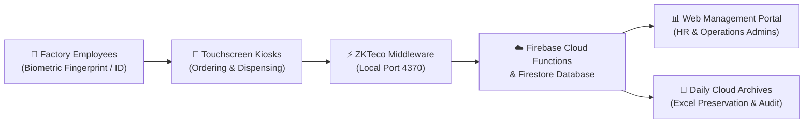

# Hayleys Eco Solutions — Meal Management System
## System Workflow, Kiosk UI & Operational Standard Operating Procedure (SOP) Guide

---

## 📌 Executive Overview

The **Hayleys Eco Solutions Meal Management System** is a unified industrial catering and workforce meal scheduling platform. It bridges factory floor employee touchpoints with real-time central kitchen operations, HR payroll reconciliation, and corporate audit reporting.



---

## 🖼️ Printable Kiosk Workflow Posters & Interactive Guides

| Asset | Description | Format | Link |
| :--- | :--- | :---: | :--- |
| **Interactive Kiosk Guide** | Dual-kiosk interactive viewer with print/download | HTML | [kiosk_workflow_guide.html](file:///d:/firebaselearning/meal-management-project/kiosk_workflow_guide.html) |
| **Meal Ordering Guide Poster** | High-resolution A1 Landscape poster for ordering stations | PNG (2800×1980) | [user_workflow_guide.png](file:///d:/firebaselearning/meal-management-project/screenshots/user_workflow_guide.png) |
| **Meal Dispensing Guide Poster** | High-resolution A1 Landscape poster for canteen counters | PNG (2800×1980) | [receiving_workflow_guide.png](file:///d:/firebaselearning/meal-management-project/screenshots/receiving_workflow_guide.png) |
| **Web Portal User Manual** | Official administrative PDF operations manual | PDF (4 MB) | [public/docs/Meal_Management_Web_Portal_User_Manual.pdf](file:///d:/firebaselearning/meal-management-project/public/docs/Meal_Management_Web_Portal_User_Manual.pdf) |

---

## 📱 Module 1: Touchscreen Meal Ordering Kiosk (`Ordering-Kiosk.exe`)

The Ordering Kiosk enables employees to reserve meals in advance through an ergonomic, dark navy blue touchscreen interface.

### 1.1 Login & Standby Screen


- **Prominent Bilingual Brand Header:**
  - **`MEAL MANAGEMENT SYSTEM`** (English, 24pt bold)
  - **`ආහාර කළමනාකරණ පද්ධතිය`** (Sinhala, 19pt bold)
  - Subtitle: *`Meal Ordering & Scheduling Kiosk \| කෑම ඇණවුම් කිරීමේ පද්ධතිය \| உணவு முன்பதிவு`*
- **Centered Clean Card:** Side terminal logs have been completely removed from the login screen to provide a focused, distraction-free touch interface.
- **Biometric Scan:** Automatic 0ms identification via ZKTeco MB360 fingerprint scanner.
- **On-Screen Numeric Keypad:** High-contrast 3×4 touch buttons for manual Employee ID entry, with dedicated `⌫ Del`, `Clear 🗑️`, and large `LOGIN / ENTER (ඇතුල් වන්න)` action button.

---

### 1.2 Day Selection & Meal Configuration


- **Single-Day Selection Choice (No Date Ranges):**
  Employees choose exactly one of three distinct booking days:
  1. **`Today (අද \| இன்று)`** — Reservations for the current calendar day.
  2. **`Tomorrow (හෙට \| நாளை)`** — Advance booking for the next day.
  3. **`Other Next Day (අනිද්දා)`** — Advance booking for the day after tomorrow.
- **Strict Portion Cap (Maximum 1):**
  - Increments are strictly restricted between **`0` and `1` portion per meal slot**.
  - The `+` button automatically disables when 1 portion is selected (`[Max: 1 | උපරිම: 1]`).
- **Same-Day Cutoff Policy:**
  - **Breakfast:** 09:00 AM sharp
  - **Lunch:** 11:00 AM sharp
  - **Dinner:** 04:00 PM sharp
  > [!IMPORTANT]
  > Cutoff restrictions apply **strictly when ordering for Today**. When **Tomorrow** or **Other Next Day** is selected, meal booking is **always open and never disabled**.

---

### 1.3 Upcoming Bookings & Confirmation


- **One-Tap Submission:** Tap the prominent blue `CONFIRM & PLACE MEAL ORDER` button to push allocations to Firestore.
- **Live 7-Day Bookings Sidebar:** On every subsequent login, employees immediately see their upcoming bookings on the right-hand panel, tagged by meal type and status.
- **Duplicate Prevention:** The kiosk automatically detects and alerts if a meal has already been allocated for the selected day, preventing double bookings.

---

## 🍲 Module 2: Touchscreen Meal Dispensing Kiosk (`Receiving-Kiosk.exe`)

The Dispensing Kiosk is situated at the plant canteen dispensing counter to verify employee entitlements and dispense meals.

### 2.1 Identification Screen


- **Prominent Bilingual Brand Header:**
  - **`MEAL MANAGEMENT SYSTEM`** (English, 24pt bold)
  - **`ආහාර කළමනාකරණ පද්ධතිය`** (Sinhala, 19pt bold)
  - Subtitle: *`Meal Dispensing & Verification Kiosk \| කෑම ලබාගැනීමේ පද්ධතිය \| உணவு விநியோகம்`*
- **Centered Layout:** Zero clutter; features canteen serving hours and live dispensed statistics (`Total Orders` vs. `Dispensed`).
- **Touch Authentication:** Employees touch the fingerprint sensor or enter their ID and tap **`IDENTIFY & COLLECT (හඳුනාගෙන ලබාගන්න)`**.

---

### 2.2 Meal Verification & Dispense Rules
- **Serving Window Enforcement:**
  - 🍳 **Breakfast:** 06:00 AM – 09:00 AM
  - 🍛 **Lunch:** 11:00 AM – 02:00 PM
  - 🍲 **Dinner:** 04:00 PM – 09:30 PM
- **Active Meal Glowing State:** During the open serving window, the corresponding meal card glows blue and unlocks the **`CONFIRM & DISPENSE`** button.
- **Duplicate Dispense Lock:** Once a meal is marked as `Received`, any secondary punch or attempt immediately flashes an amber alert: *`Already Dispensed Today (දැනටමත් ලබාගෙන ඇත)`*.

---

## 💻 Module 3: Web Management Portal (Admin & HR)

The React/Ant-Design web portal (`npm run dev` / Firebase Hosting) serves plant management:

| Module | Route | Capabilities |
| :--- | :--- | :--- |
| **01. Secure Login** | `#/admin/login` | Encrypted session login with role-based route guards. |
| **02. Operations Dashboard** | `#/admin/dashboard` | Real-time meal KPIs, portion progress bars, and designation breakdown. |
| **03. Today's Allocations** | `#/admin/reports` | Live meal allocation table, real-time sync, and Excel export. |
| **04. Previous Day Allocations** | `#/admin/all-allocations` | Defaults to previous day with From–To date range filters and exact employee company mapping. |
| **05. Daily Archived Reports** | `#/admin/daily-archive` | Automated target-day Excel workbooks preserved in Cloud Storage, with on-demand deletion. |
| **06. Employees Directory** | `#/admin/employees` | 579+ workforce roster, Excel template upload/download, and category editing. |
| **07. Master Data** | `#/admin/settings` | Subsidy rules (Full/Half/None), operating companies, and database maintenance tools. |
| **08. Kiosk Guides** | `#/admin/guide` | In-portal interactive guides and direct high-resolution PNG poster downloads. |

---

## 🚀 Build & Deployment Commands

### Standalone Desktop Kiosk Executables (Windows `.exe`)
```powershell
# Compiles Ordering-Kiosk.exe and Receiving-Kiosk.exe in desktopapp/dist/
python desktopapp/build_executables.py
```

### Web Portal Build & Deployment
```powershell
# Build frontend bundle
cmd.exe /c npm run build

# Deploy Web Portal and Cloud Functions to Firebase Live
firebase deploy --only hosting,functions
```

